# SVG Rendering Comparison

Side-by-side rendering, browser similarity scores, file sizes, and benchmark times for 44 SVG test cases across all four libraries.

> **Note:** The **Input SVG** column is rendered live by your browser's built-in SVG engine. Use it as a reference to compare each library's PNG output against what a modern browser produces.

## Browser Similarity Score

The **Similarity** row scores how closely each library's PNG matches a browser rendering of the input SVG, captured with Chromium 157.0.8103.38 snap (headless) at the SVG's intrinsic size and device scale factor 1 (baselines in [`visual/png/chrome/`](visual/png/chrome/)). The score is the mean [SSIM](https://en.wikipedia.org/wiki/Structural_similarity_index_measure) over the R, G, and B channels (8×8 windows) after compositing both images onto white, scaled to 0–100 (100 = identical). Output with a different size is resampled to the baseline size first. **N/A** means the library produced no output.

> **Caveats:** the score measures visual similarity to one browser engine, not SVG specification compliance. Font availability and anti-aliasing affect it, and large blank areas inflate it, so small differences (a point or two) are not meaningful. Use the images to judge the details.

| Average similarity | JairoSVG | EchoSVG | CairoSVG | JSVG |
| :----------------- | :------: | :-----: | :------: | :--: |
| **Score (0–100)** | 92.5 | **95.0** ✅ | 89.5 | 89.3 |
| **Cases scored** | 44/44 | 44/44 | 42/44 | 44/44 |

> Averages include only the cases each library rendered.

> **Fastest ✅ requires accuracy:** in each **Time** row, the ✅ goes to the fastest library whose output is accurate. Starting from the fastest, a library is skipped if it has no similarity score or the lowest similarity in that row (unless all scores are tied), and the next fastest is considered.

### 01_basic_shapes

Rectangles, circles, ellipses, and lines with solid fills and strokes.

| Input SVG | JairoSVG | EchoSVG | CairoSVG | JSVG |
| :-------: | :------: | :-----: | :------: | :--: |
|  |  | 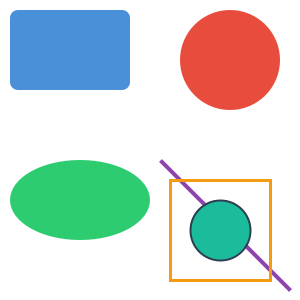 |  | 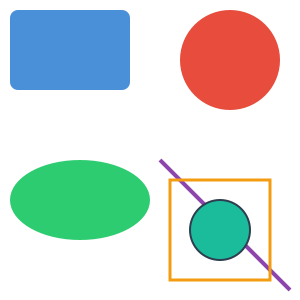 |
| **Size** | 6,718 bytes ✅ | 8,162 bytes | 8,920 bytes | 7,031 bytes |
| **Similarity** | **99.9** ✅ | 99.1 | **99.9** ✅ | **99.9** ✅ |
| **Time** | **6.0665 ms** ✅ | 27.5072 ms | 9.6386 ms | 6.1010 ms |

### 02_gradients

Linear and radial gradients with color stops and spread methods.

| Input SVG | JairoSVG | EchoSVG | CairoSVG | JSVG |
| :-------: | :------: | :-----: | :------: | :--: |
|  |  | 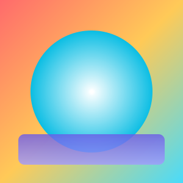 | 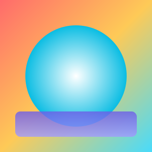 | 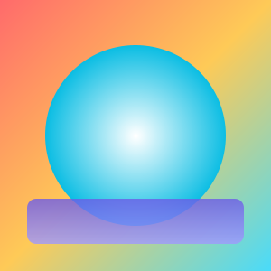 |
| **Size** | 25,554 bytes | 25,024 bytes | 23,637 bytes ✅ | 26,410 bytes |
| **Similarity** | **99.6** ✅ | **99.6** ✅ | **99.6** ✅ | **99.6** ✅ |
| **Time** | **8.0627 ms** ✅ | 187.2354 ms | 18.4474 ms | 8.3179 ms |

### 03_complex_paths

Cubic/quadratic Bézier curves, arcs, and complex path commands.

| Input SVG | JairoSVG | EchoSVG | CairoSVG | JSVG |
| :-------: | :------: | :-----: | :------: | :--: |
|  |  | 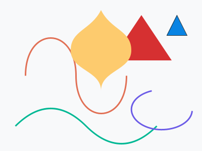 |  |  |
| **Size** | 12,657 bytes ✅ | 16,936 bytes | 15,633 bytes | 12,730 bytes |
| **Similarity** | **99.9** ✅ | 98.6 | **99.9** ✅ | **99.9** ✅ |
| **Time** | **7.6518 ms** ✅ | 37.9172 ms | 9.5225 ms | 7.8154 ms |

### 04_text_rendering

Text rendering with different fonts, sizes, weights, and tspan.

| Input SVG | JairoSVG | EchoSVG | CairoSVG | JSVG |
| :-------: | :------: | :-----: | :------: | :--: |
| 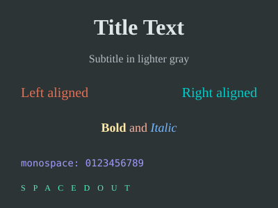 | 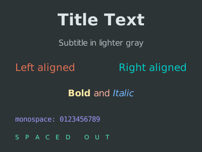 | 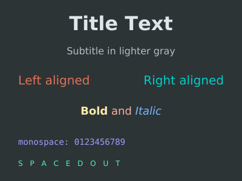 | 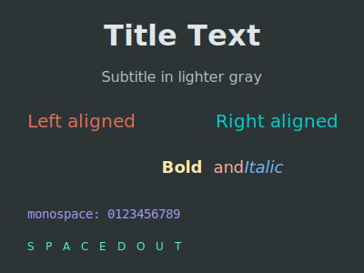 | 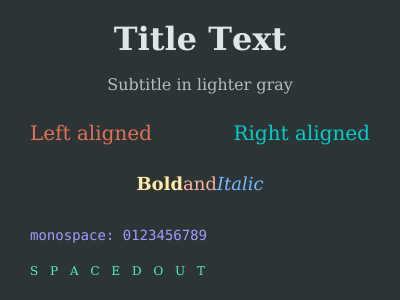 |
| **Size** | 13,731 bytes ✅ | 19,192 bytes | 16,247 bytes | 16,732 bytes |
| **Similarity** | 89.9 | **96.5** ✅ | 89.8 | 88.9 |
| **Time** | **8.5419 ms** ✅ | 40.5922 ms | 13.5578 ms | 9.1445 ms |

### 05_transforms

Translate, rotate, scale, skewX, and nested group transforms.

| Input SVG | JairoSVG | EchoSVG | CairoSVG | JSVG |
| :-------: | :------: | :-----: | :------: | :--: |
|  |  |  |  | 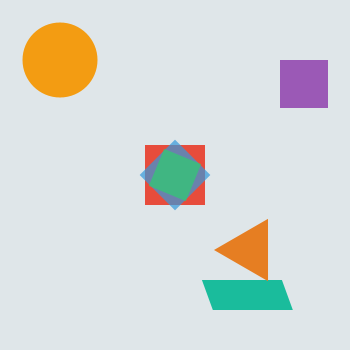 |
| **Size** | 5,461 bytes | 5,297 bytes ✅ | 6,001 bytes | 5,827 bytes |
| **Similarity** | **100.0** ✅ | 99.9 | **100.0** ✅ | **100.0** ✅ |
| **Time** | 7.1075 ms | 25.1370 ms | 8.5847 ms | **6.9391 ms** ✅ |

### 06_stroke_styles

Dash arrays, line caps (butt/round/square), and line joins.

| Input SVG | JairoSVG | EchoSVG | CairoSVG | JSVG |
| :-------: | :------: | :-----: | :------: | :--: |
| 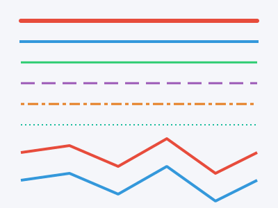 | 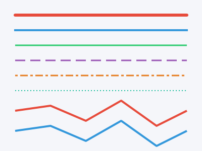 | 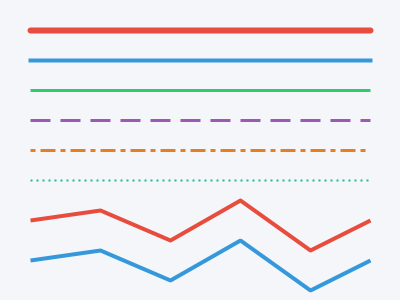 |  |  |
| **Size** | 3,363 bytes ✅ | 5,038 bytes | 4,478 bytes | 4,074 bytes |
| **Similarity** | **100.0** ✅ | 96.0 | **100.0** ✅ | **100.0** ✅ |
| **Time** | 7.0145 ms | 21.5139 ms | 7.7271 ms | **6.4940 ms** ✅ |

### 07_opacity_blend

Fill opacity, stroke opacity, and layered element opacity.

| Input SVG | JairoSVG | EchoSVG | CairoSVG | JSVG |
| :-------: | :------: | :-----: | :------: | :--: |
|  | 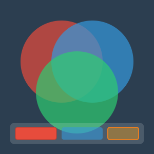 | 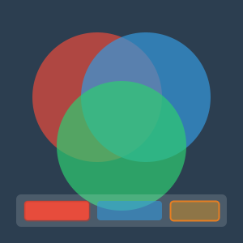 | 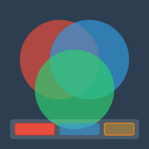 |  |
| **Size** | 8,409 bytes ✅ | 10,203 bytes | 9,853 bytes | 8,788 bytes |
| **Similarity** | **99.9** ✅ | 99.5 | **99.9** ✅ | **99.9** ✅ |
| **Time** | **6.1710 ms** ✅ | 30.2883 ms | 7.5199 ms | 6.4064 ms |

### 08_viewbox_aspect

viewBox scaling with different preserveAspectRatio values.

| Input SVG | JairoSVG | EchoSVG | CairoSVG | JSVG |
| :-------: | :------: | :-----: | :------: | :--: |
| 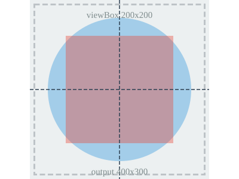 | 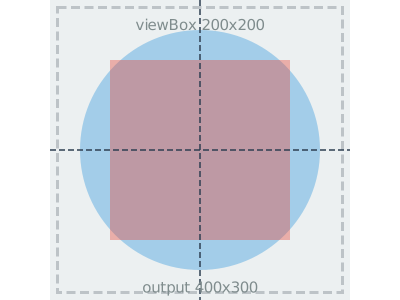 | 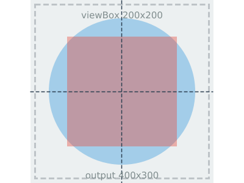 | 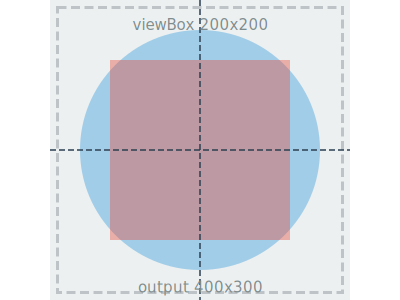 | 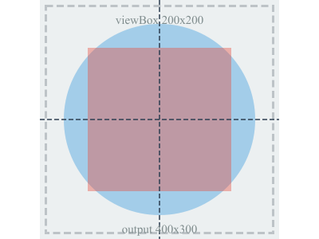 |
| **Size** | 10,650 bytes ✅ | 13,154 bytes | 11,869 bytes | 13,425 bytes |
| **Similarity** | 97.9 | 98.4 | 97.9 | **99.0** ✅ |
| **Time** | 8.7013 ms | 35.5334 ms | 11.9496 ms | **8.7436 ms** ✅ |

### 09_css_styling

CSS `<style>` block with class and ID selectors.

| Input SVG | JairoSVG | EchoSVG | CairoSVG | JSVG |
| :-------: | :------: | :-----: | :------: | :--: |
| 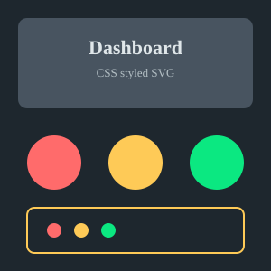 |  |  | 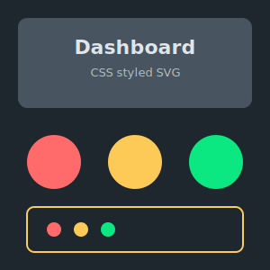 |  |
| **Size** | 7,910 bytes ✅ | 11,071 bytes | 10,718 bytes | 9,110 bytes |
| **Similarity** | 98.7 | 97.9 | **99.6** ✅ | 98.0 |
| **Time** | **6.0491 ms** ✅ | 26.5093 ms | 9.7926 ms | 6.2307 ms |

### 10_use_and_defs

`<use>` element references, `<clipPath>`, and `<defs>` reuse.

| Input SVG | JairoSVG | EchoSVG | CairoSVG | JSVG |
| :-------: | :------: | :-----: | :------: | :--: |
|  |  |  | 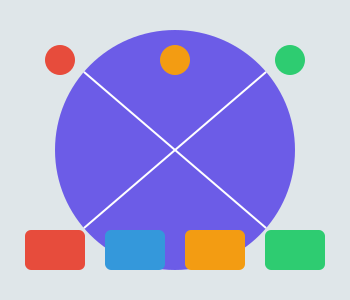 |  |
| **Size** | 5,448 bytes ✅ | 6,122 bytes | 9,712 bytes | 6,144 bytes |
| **Similarity** | 99.5 | 98.5 | **99.9** ✅ | 99.5 |
| **Time** | 6.9453 ms | 25.1068 ms | 10.0316 ms | **6.9132 ms** ✅ |

### 11_star_polygon

Complex star polygon with fill-rule evenodd.

| Input SVG | JairoSVG | EchoSVG | CairoSVG | JSVG |
| :-------: | :------: | :-----: | :------: | :--: |
|  |  |  |  |  |
| **Size** | 6,228 bytes ✅ | 8,862 bytes | 8,911 bytes | 6,455 bytes |
| **Similarity** | **99.9** ✅ | 97.7 | **99.9** ✅ | **99.9** ✅ |
| **Time** | **5.8136 ms** ✅ | 24.7735 ms | 6.4629 ms | 5.8269 ms |

### 12_nested_svg

Nested `<svg>` elements with independent viewports.

| Input SVG | JairoSVG | EchoSVG | CairoSVG | JSVG |
| :-------: | :------: | :-----: | :------: | :--: |
|  | 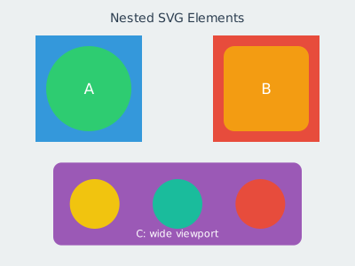 |  |  | 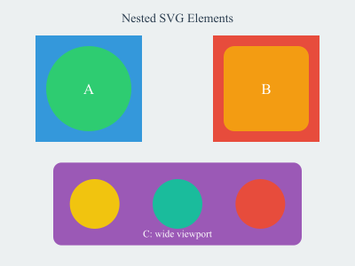 |
| **Size** | 11,040 bytes ✅ | 12,666 bytes | 11,719 bytes | 12,735 bytes |
| **Similarity** | 98.7 | **99.5** ✅ | 98.9 | 97.9 |
| **Time** | **8.1016 ms** ✅ | 32.9818 ms | 10.9538 ms | 8.1300 ms |

### 13_patterns

Tiled pattern fills: dots, cross-hatch stripes, and grid lines.

| Input SVG | JairoSVG | EchoSVG | CairoSVG | JSVG |
| :-------: | :------: | :-----: | :------: | :--: |
| 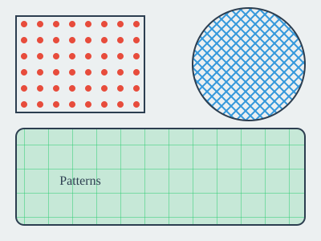 |  | 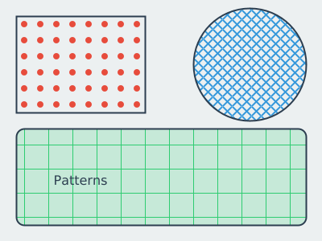 |  |  |
| **Size** | 9,561 bytes ✅ | 11,827 bytes | 12,258 bytes | 11,224 bytes |
| **Similarity** | **99.6** ✅ | 91.4 | 83.9 | 99.4 |
| **Time** | **8.2403 ms** ✅ | 29.4034 ms | 10.7206 ms | 8.4322 ms |

### 14_clip_paths

Star and text clip paths applied to gradient fills.

| Input SVG | JairoSVG | EchoSVG | CairoSVG | JSVG |
| :-------: | :------: | :-----: | :------: | :--: |
|  |  |  |  |  |
| **Size** | 9,480 bytes ✅ | 10,489 bytes | 13,289 bytes | 10,671 bytes |
| **Similarity** | 97.6 | 99.3 | **99.9** ✅ | 94.3 |
| **Time** | **7.6054 ms** ✅ | 45.6134 ms | 11.4663 ms | 8.1245 ms |

### 15_masks

Horizontal, vertical, and circular gradient masks with luminance blending.

| Input SVG | JairoSVG | EchoSVG | CairoSVG | JSVG |
| :-------: | :------: | :-----: | :------: | :--: |
| 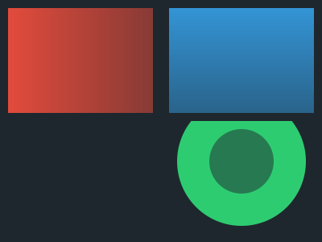 |  | 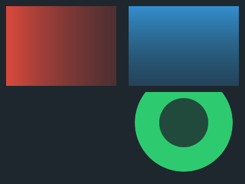 | 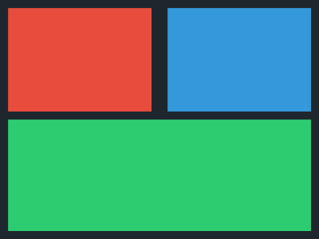 |  |
| **Size** | 5,692 bytes | 5,545 bytes | 1,195 bytes ✅ | 6,209 bytes |
| **Similarity** | **99.8** ✅ | 97.9 | 81.3 | **99.8** ✅ |
| **Time** | **8.4689 ms** ✅ | 35.5737 ms | 10.9215 ms | 8.7538 ms |

### 16_markers

Arrow, dot, and square markers on lines, polylines, and curves.

| Input SVG | JairoSVG | EchoSVG | CairoSVG | JSVG |
| :-------: | :------: | :-----: | :------: | :--: |
|  | 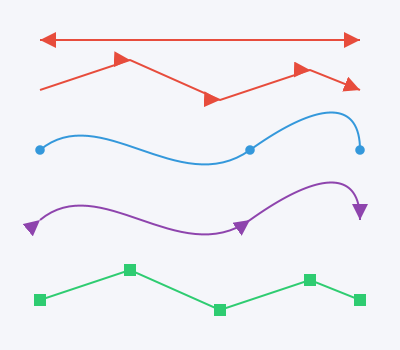 |  |  |  |
| **Size** | 9,796 bytes ✅ | 12,642 bytes | 12,655 bytes | 10,041 bytes |
| **Similarity** | **100.0** ✅ | 97.7 | 99.6 | 99.9 |
| **Time** | **8.4858 ms** ✅ | 31.0043 ms | 13.0821 ms | 8.5111 ms |

### 17_filters

Gaussian blur and drop-shadow filters on shapes and text.

| Input SVG | JairoSVG | EchoSVG | CairoSVG | JSVG |
| :-------: | :------: | :-----: | :------: | :--: |
| 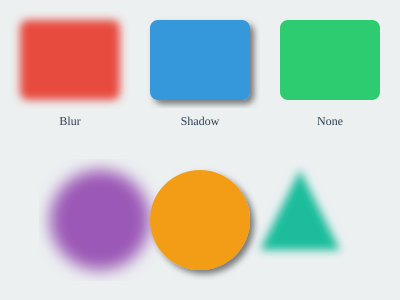 | 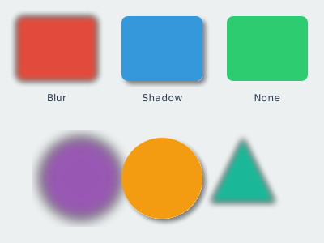 | 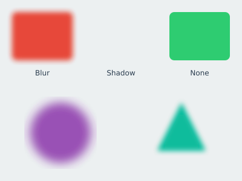 | 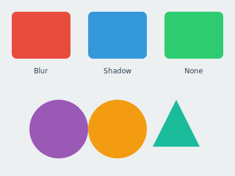 |  |
| **Size** | 29,009 bytes | 24,096 bytes | 8,435 bytes ✅ | 32,647 bytes |
| **Similarity** | 95.4 | 91.1 | 89.0 | **99.3** ✅ |
| **Time** | **14.1871 ms** ✅ | 55.9347 ms | 9.7164 ms | 19.1618 ms |

### 18_embedded_image

Base64-encoded PNG images with clipping, transforms, and opacity.

| Input SVG | JairoSVG | EchoSVG | CairoSVG | JSVG |
| :-------: | :------: | :-----: | :------: | :--: |
| 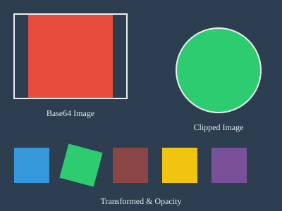 | 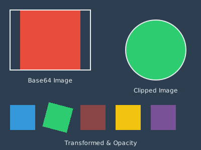 |  | 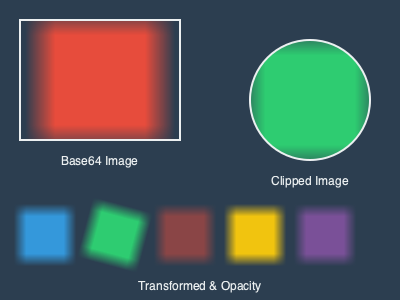 | 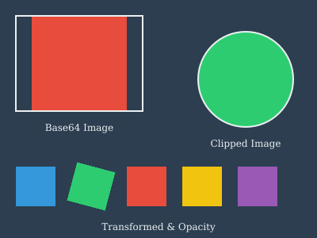 |
| **Size** | 9,640 bytes ✅ | 12,151 bytes | 20,970 bytes | 12,442 bytes |
| **Similarity** | **97.5** ✅ | 97.0 | 90.0 | 97.2 |
| **Time** | **8.3646 ms** ✅ | 30.5515 ms | 15.3621 ms | 11.1222 ms |

### 19_text_advanced

Multi-span text (tspan), text-decoration, textPath on curves, and rotated text.

| Input SVG | JairoSVG | EchoSVG | CairoSVG | JSVG |
| :-------: | :------: | :-----: | :------: | :--: |
| 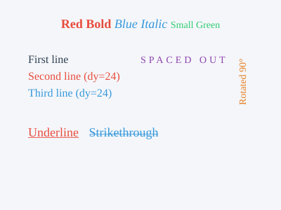 | 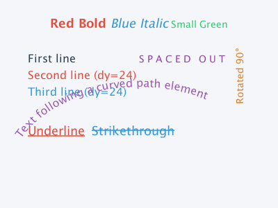 | 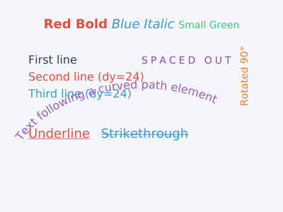 | 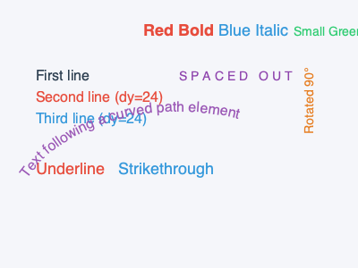 | 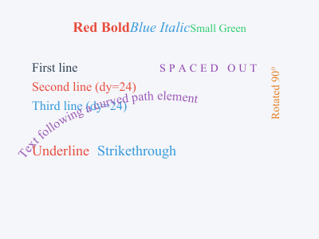 |
| **Size** | 19,628 bytes ✅ | 27,649 bytes | 24,244 bytes | 22,638 bytes |
| **Similarity** | 87.5 | **93.0** ✅ | 87.4 | 84.9 |
| **Time** | **9.5062 ms** ✅ | 46.6130 ms | 21.1859 ms | 9.8438 ms |

### 20_fe_blend_modes

feBlend modes: normal, multiply, screen, darken, and lighten.

| Input SVG | JairoSVG | EchoSVG | CairoSVG | JSVG |
| :-------: | :------: | :-----: | :------: | :--: |
|  | 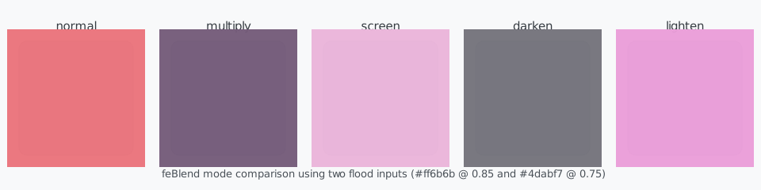 | 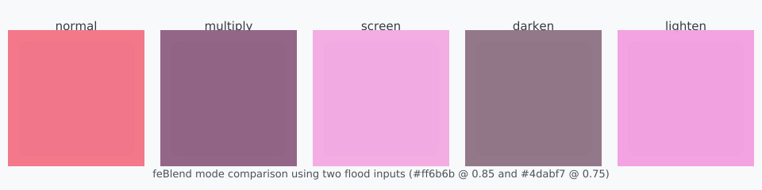 | 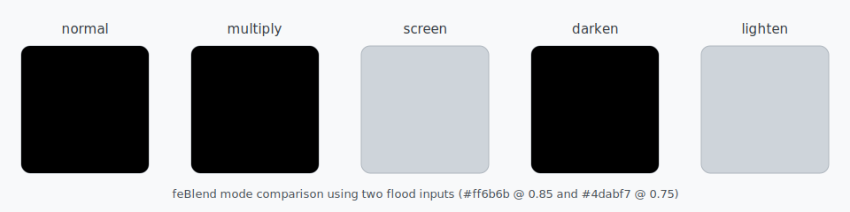 |  |
| **Size** | 12,246 bytes ✅ | 16,961 bytes | 12,592 bytes | 16,449 bytes |
| **Similarity** | 95.4 | **96.1** ✅ | 53.2 | 92.9 |
| **Time** | **19.9493 ms** ✅ | 52.6980 ms | 34.9107 ms | 45.7585 ms |

### 21_fe_tile

`feTile` filter primitive: repeating input across the filter region.

| Input SVG | JairoSVG | EchoSVG | CairoSVG | JSVG |
| :-------: | :------: | :-----: | :------: | :--: |
|  |  |  |  |  |
| **Size** | 1,456 bytes ✅ | 2,002 bytes | 1,768 bytes | 1,489 bytes |
| **Similarity** | **100.0** ✅ | **100.0** ✅ | **100.0** ✅ | **100.0** ✅ |
| **Time** | 4.7328 ms | 12.9337 ms | 6.0115 ms | **4.7119 ms** ✅ |

### 22_feimage_data_uri

`feImage` with data-URI PNG source.

| Input SVG | JairoSVG | EchoSVG | CairoSVG | JSVG |
| :-------: | :------: | :-----: | :------: | :--: |
|  |  |  |  |  |
| **Size** | 2,559 bytes ✅ | 4,363 bytes | 3,333 bytes | 3,792 bytes |
| **Similarity** | 80.6 | **98.9** ✅ | 62.4 | 61.7 |
| **Time** | **2.9953 ms** ✅ | 9.7848 ms | 4.2530 ms | 3.2571 ms |

### 23_feimage_inline_ref

`feImage` referencing an inline SVG element by fragment ID.

| Input SVG | JairoSVG | EchoSVG | CairoSVG | JSVG |
| :-------: | :------: | :-----: | :------: | :--: |
|  |  |  |  |  |
| **Size** | 2,873 bytes ✅ | 3,629 bytes | 4,849 bytes | 4,564 bytes |
| **Similarity** | 85.2 | **98.7** ✅ | 71.1 | 68.9 |
| **Time** | **3.1714 ms** ✅ | 9.4195 ms | 4.2827 ms | 3.3617 ms |

### 24_localized_masks

Masks with localized coordinate systems and gradient fills.

| Input SVG | JairoSVG | EchoSVG | CairoSVG | JSVG |
| :-------: | :------: | :-----: | :------: | :--: |
|  |  |  |  |  |
| **Size** | 18,389 bytes | 19,078 bytes | 15,803 bytes ✅ | 20,239 bytes |
| **Similarity** | **100.0** ✅ | 99.4 | 93.8 | 99.8 |
| **Time** | **27.7392 ms** ✅ | 92.4768 ms | 49.9375 ms | 28.3198 ms |

### 25_svg_fonts

Custom SVG font with glyph paths and missing-glyph fallback.

| Input SVG | JairoSVG | EchoSVG | CairoSVG | JSVG |
| :-------: | :------: | :-----: | :------: | :--: |
|  |  |  |  |  |
| **Size** | 10,261 bytes ✅ | 14,232 bytes | 15,180 bytes | 13,039 bytes |
| **Similarity** | 80.5 | 83.7 | **96.0** ✅ | 84.2 |
| **Time** | 6.5208 ms | 29.9910 ms | 9.8196 ms | **6.8422 ms** ✅ |

### 26_symbol_use

Reusable `<symbol>` elements instantiated with `<use>` at different sizes and positions.

| Input SVG | JairoSVG | EchoSVG | CairoSVG | JSVG |
| :-------: | :------: | :-----: | :------: | :--: |
|  |  |  |  |  |
| **Size** | 16,492 bytes ✅ | 24,570 bytes | 21,651 bytes | 18,734 bytes |
| **Similarity** | 95.6 | 96.9 | **97.4** ✅ | 89.3 |
| **Time** | **8.4330 ms** ✅ | 42.6966 ms | 22.3546 ms | 8.7897 ms |

### 27_switch_features

`<switch>` element with requiredFeatures and systemLanguage conditional rendering.

| Input SVG | JairoSVG | EchoSVG | CairoSVG | JSVG |
| :-------: | :------: | :-----: | :------: | :--: |
|  |  |  |  |  |
| **Size** | 11,501 bytes | 18,424 bytes | 13,357 bytes | 9,490 bytes ✅ |
| **Similarity** | 90.3 | **97.1** ✅ | 87.2 | 69.4 |
| **Time** | **7.4478 ms** ✅ | 35.7435 ms | 14.4227 ms | 6.5211 ms |

### 28_css_variables

CSS custom properties with `var()` function and fallback values.

| Input SVG | JairoSVG | EchoSVG | CairoSVG | JSVG |
| :-------: | :------: | :-----: | :------: | :--: |
|  |  |  | — |  |
| **Size** | 11,493 bytes ✅ | 17,538 bytes | — | 13,229 bytes |
| **Similarity** | 93.1 | **98.1** ✅ | N/A | 58.4 |
| **Time** | **7.3309 ms** ✅ | 34.3244 ms | — | 7.4431 ms |

### 29_current_color

`currentColor` keyword for fill, stroke, and gradient stops with nested inheritance.

| Input SVG | JairoSVG | EchoSVG | CairoSVG | JSVG |
| :-------: | :------: | :-----: | :------: | :--: |
|  |  |  |  |  |
| **Size** | 10,487 bytes ✅ | 14,699 bytes | 10,856 bytes | 14,092 bytes |
| **Similarity** | 92.6 | **97.6** ✅ | 94.8 | 88.7 |
| **Time** | **7.2576 ms** ✅ | 32.2890 ms | 14.1502 ms | 7.6474 ms |

### 30_display_visibility

`display:none` vs `visibility:hidden` behavior, group suppression, and child override.

| Input SVG | JairoSVG | EchoSVG | CairoSVG | JSVG |
| :-------: | :------: | :-----: | :------: | :--: |
|  |  |  |  |  |
| **Size** | 10,469 bytes ✅ | 18,500 bytes | 13,264 bytes | 15,729 bytes |
| **Similarity** | 86.4 | **96.1** ✅ | 91.9 | 86.7 |
| **Time** | 8.0251 ms | 37.5470 ms | 18.0680 ms | **8.9977 ms** ✅ |

### 31_nested_overflow

Nested `<svg>` elements with `overflow` values: hidden, scroll, visible, and auto.

| Input SVG | JairoSVG | EchoSVG | CairoSVG | JSVG |
| :-------: | :------: | :-----: | :------: | :--: |
|  |  |  |  |  |
| **Size** | 11,510 bytes ✅ | 16,534 bytes | 14,045 bytes | 14,704 bytes |
| **Similarity** | 90.3 | **96.6** ✅ | 94.0 | 91.6 |
| **Time** | 7.8449 ms | 37.1876 ms | 14.1733 ms | **8.1618 ms** ✅ |

### 32_stroke_advanced

`stroke-dashoffset` phase shifting and `stroke-miterlimit` miter-to-bevel fallback.

| Input SVG | JairoSVG | EchoSVG | CairoSVG | JSVG |
| :-------: | :------: | :-----: | :------: | :--: |
|  |  |  |  |  |
| **Size** | 9,681 bytes ✅ | 15,298 bytes | 12,442 bytes | 12,839 bytes |
| **Similarity** | 93.9 | 94.0 | **95.8** ✅ | 93.1 |
| **Time** | **7.0890 ms** ✅ | 34.0139 ms | 13.5689 ms | 7.2720 ms |

### 33_pattern_transforms

`patternTransform` with scale, rotate, translate, and combined transforms.

| Input SVG | JairoSVG | EchoSVG | CairoSVG | JSVG |
| :-------: | :------: | :-----: | :------: | :--: |
|  |  |  |  |  |
| **Size** | 8,768 bytes ✅ | 16,305 bytes | 15,765 bytes | 16,955 bytes |
| **Similarity** | 90.0 | **92.0** ✅ | 91.8 | 89.4 |
| **Time** | **7.4235 ms** ✅ | 37.7768 ms | 15.9612 ms | 7.8448 ms |

### 34_gradient_advanced

Gradient `spreadMethod` (reflect/repeat/pad), `fx`/`fy` focus, `href` inheritance, and `userSpaceOnUse`.

| Input SVG | JairoSVG | EchoSVG | CairoSVG | JSVG |
| :-------: | :------: | :-----: | :------: | :--: |
|  |  |  |  |  |
| **Size** | 31,462 bytes | 36,426 bytes | 30,154 bytes ✅ | 36,655 bytes |
| **Similarity** | 91.1 | **98.4** ✅ | 95.0 | 93.3 |
| **Time** | 13.0461 ms | 72.4096 ms | 26.6265 ms | **13.5895 ms** ✅ |

### 35_filter_merge_offset

`feMerge` for compositing layers and `feOffset` for position shifting with shadow effects.

| Input SVG | JairoSVG | EchoSVG | CairoSVG | JSVG |
| :-------: | :------: | :-----: | :------: | :--: |
|  |  |  |  |  |
| **Size** | 8,984 bytes ✅ | 15,354 bytes | 14,302 bytes | 13,136 bytes |
| **Similarity** | 89.6 | **97.6** ✅ | 80.1 | 88.7 |
| **Time** | **11.1021 ms** ✅ | 35.1845 ms | 14.9296 ms | 22.5635 ms |

### 36_fe_color_matrix

`feColorMatrix` with type matrix, saturate, hueRotate, and luminanceToAlpha.

| Input SVG | JairoSVG | EchoSVG | CairoSVG | JSVG |
| :-------: | :------: | :-----: | :------: | :--: |
|  |  |  |  |  |
| **Size** | 13,170 bytes | 15,944 bytes | 10,674 bytes ✅ | 15,340 bytes |
| **Similarity** | 87.4 | **94.1** ✅ | 76.9 | 90.4 |
| **Time** | **7.0570 ms** ✅ | 31.7837 ms | 14.2195 ms | 7.8294 ms |

### 37_fe_morphology

`feMorphology` erode and dilate operators on text, shapes, and circles.

| Input SVG | JairoSVG | EchoSVG | CairoSVG | JSVG |
| :-------: | :------: | :-----: | :------: | :--: |
|  |  |  |  |  |
| **Size** | 10,340 bytes ✅ | 14,225 bytes | 11,956 bytes | 10,492 bytes |
| **Similarity** | 89.6 | **96.4** ✅ | 85.8 | 82.8 |
| **Time** | **7.7712 ms** ✅ | 33.7037 ms | 14.0407 ms | 11.0448 ms |

### 38_fe_turbulence

`feTurbulence` fractalNoise and turbulence types with varying frequency and octaves.

| Input SVG | JairoSVG | EchoSVG | CairoSVG | JSVG |
| :-------: | :------: | :-----: | :------: | :--: |
|  |  |  |  |  |
| **Size** | 77,685 bytes | 64,352 bytes | 8,796 bytes ✅ | 77,435 bytes |
| **Similarity** | 50.8 | **82.0** ✅ | 49.7 | 78.1 |
| **Time** | 21.0325 ms | 58.5430 ms | 13.8818 ms | **16.7342 ms** ✅ |

### 39_fe_displacement_map

`feDisplacementMap` distortion using a turbulence displacement source.

| Input SVG | JairoSVG | EchoSVG | CairoSVG | JSVG |
| :-------: | :------: | :-----: | :------: | :--: |
|  |  |  |  |  |
| **Size** | 9,346 bytes ✅ | 18,738 bytes | 9,893 bytes | 11,210 bytes |
| **Similarity** | 78.6 | **92.6** ✅ | 79.4 | 78.1 |
| **Time** | 13.0308 ms | 36.9085 ms | **10.6352 ms** ✅ | 25.8575 ms |

### 40_fe_lighting

`feDiffuseLighting` and `feSpecularLighting` with distant and point light sources.

| Input SVG | JairoSVG | EchoSVG | CairoSVG | JSVG |
| :-------: | :------: | :-----: | :------: | :--: |
|  |  |  |  |  |
| **Size** | 12,942 bytes | 18,815 bytes | 9,280 bytes ✅ | 11,116 bytes |
| **Similarity** | 89.2 | **98.2** ✅ | 85.8 | 82.6 |
| **Time** | **9.9697 ms** ✅ | 40.3704 ms | 12.3849 ms | 9.9015 ms |

### 41_fe_convolve_matrix

`feConvolveMatrix` convolution effects: emboss, edge detection, sharpen, and box blur.

| Input SVG | JairoSVG | EchoSVG | CairoSVG | JSVG |
| :-------: | :------: | :-----: | :------: | :--: |
|  |  |  |  |  |
| **Size** | 12,190 bytes | 6,858 bytes ✅ | 8,635 bytes | 9,417 bytes |
| **Similarity** | 86.3 | 64.4 | **87.7** ✅ | 83.3 |
| **Time** | **8.2672 ms** ✅ | — | 12.7586 ms | 18.7595 ms |

### 42_fe_component_transfer

`feComponentTransfer` with gamma, discrete, linear, and table transfer functions.

| Input SVG | JairoSVG | EchoSVG | CairoSVG | JSVG |
| :-------: | :------: | :-----: | :------: | :--: |
|  |  |  |  |  |
| **Size** | 9,316 bytes ✅ | 13,176 bytes | 9,877 bytes | 11,336 bytes |
| **Similarity** | 83.3 | **96.6** ✅ | 74.0 | 91.6 |
| **Time** | **6.5284 ms** ✅ | 30.1682 ms | 14.7163 ms | 7.1475 ms |

### 43_css_color_level_4

CSS Color Level 4 syntax: HWB, Lab/LCH, OKLab/OKLCH, color(), alpha hex, and slash alpha.

| Input SVG | JairoSVG | EchoSVG | CairoSVG | JSVG |
| :-------: | :------: | :-----: | :------: | :--: |
|  |  |  | — |  |
| **Size** | 16,353 bytes ✅ | 48,916 bytes | — | 17,107 bytes |
| **Similarity** | **90.2** ✅ | 85.5 | N/A | 69.7 |
| **Time** | **9.7471 ms** ✅ | 166.1594 ms | — | 9.5484 ms |

### 44_music_notation

Verovio-style engraved score: scoped descendant CSS (`#score path`) strokes staff lines, stems, ledger lines, and barlines; `<use>` glyphs, beams, slurs, and nested `<tspan>` text.

| Input SVG | JairoSVG | EchoSVG | CairoSVG | JSVG |
| :-------: | :------: | :-----: | :------: | :--: |
|  |  |  |  |  |
| **Size** | 14,614 bytes | 17,759 bytes | 17,625 bytes | 11,997 bytes ✅ |
| **Similarity** | **99.0** ✅ | 81.6 | 98.0 | 60.2 |
| **Time** | **11.6016 ms** ✅ | 58.9051 ms | 49.4756 ms | 10.4941 ms |

---

> **⚠️ Filters/Masks caveat:** CairoSVG supports only three SVG filter primitives (`feBlend`, `feFlood`, `feOffset`) — all others (`feGaussianBlur`, `feDropShadow`, `feTurbulence`, `feDisplacementMap`, `feLighting`, `feColorMatrix`, `feMorphology`, `feConvolveMatrix`, `feComponentTransfer`, `feComposite`, `feMerge`, `feImage`, `feTile`) are silently skipped. Masks are also rendered incorrectly (missing gradient and shape content). For those tests, CairoSVG appears faster and produces smaller files because it skips the rendering work. JairoSVG and JSVG perform the actual computation. Note: JairoSVG **outperforms CairoSVG on both Masks and feBlend modes** despite rendering them correctly. CairoSVG also **crashes** on CSS custom properties (`var()`) and CSS Color Level 4 syntax — tests 28 and 43 produce no output.

<!-- BEGIN:BENCHMARK_NOTE -->
> **Note:** Benchmarks were run with 50 warm-up iterations and 500 measured iterations per SVG file. Median time reported. Results may vary by hardware and SVG complexity.
<!-- END:BENCHMARK_NOTE -->

#### Default Rendering Settings: JairoSVG vs JSVG

Both JairoSVG and JSVG use Java2D as their rendering backend, but they ship with **different default quality settings**, which directly affects benchmark performance:

| Setting                       | JairoSVG default             | JSVG default (out-of-the-box)          | Performance impact |
| ----------------------------- | ---------------------------- | -------------------------------------- | :----------------: |
| `KEY_ANTIALIASING`            | `VALUE_ANTIALIAS_ON`         | `VALUE_ANTIALIAS_ON` (auto-set)        |        Low         |
| `KEY_TEXT_ANTIALIASING`       | Not set (platform default)   | Not set (platform default)             |        Low         |
| `KEY_RENDERING`               | Not set (defaults to speed)  | Not set (defaults to speed)            |      **High**      |
| `KEY_STROKE_CONTROL`          | `VALUE_STROKE_PURE`          | `VALUE_STROKE_PURE` (auto-set)         |       Equal        |
| `KEY_FRACTIONALMETRICS`       | Not set (defaults to `OFF`)  | Not set (defaults to `OFF`)            |       Medium       |
| **PNG compression level**     | 6 (matches CairoSVG/libpng) | N/A (no built-in PNG; user uses `ImageIO`) |       Medium       |

JSVG automatically sets `KEY_ANTIALIASING` and `KEY_STROKE_CONTROL` to the values above when they are at their defaults. JairoSVG now uses the same defaults as JSVG, so both renderers operate with identical quality settings out of the box. Users can customize any hint via `JairoSVG.builder().renderingHint(key, value)`.

**In the benchmark**, both JairoSVG and JSVG use identical rendering hints, so the comparison measures SVG engine efficiency directly.

> **⚠️ Filters/Masks:** Where CairoSVG produces much smaller output, it is because CairoSVG **does not implement** most SVG filter primitives — only `feBlend`, `feFlood`, and `feOffset` are supported; all others are silently skipped. Masks are also rendered without gradient/shape content. This results in simpler images that compress better. JairoSVG and JSVG render these effects correctly, producing visually accurate but larger PNGs.

## Running the Benchmark

Prerequisites: [JBang], Java 25+, Python 3 with CairoSVG (`pip install cairosvg`), JairoSVG installed in local Maven repo.

```bash
./mvnw install -DskipTests
jbang comparison/benchmark/benchmark.java
```

Options:

```bash
# Run specific SVG categories only
jbang comparison/benchmark/benchmark.java filters embedded

# Skip engines
jbang comparison/benchmark/benchmark.java --no-cairosvg
jbang comparison/benchmark/benchmark.java --no-echosvg
jbang comparison/benchmark/benchmark.java --no-jsvg

# Disable progress bar output (useful for CI logs)
jbang comparison/benchmark/benchmark.java --no-progress

# Adjust warmup and measurement iterations (defaults: 50 and 500)
jbang comparison/benchmark/benchmark.java --warmup=5 --iterations=100
```

The benchmark writes results to `benchmark/benchmark-results.jsonl` (JSON lines) and logs to a timestamped file. The `update_readme.java` script reads the JSONL and PNG files to regenerate both the timing table and PNG file sizes table in this document.

<!-- Link references -->

[JBang]: https://www.jbang.dev/
